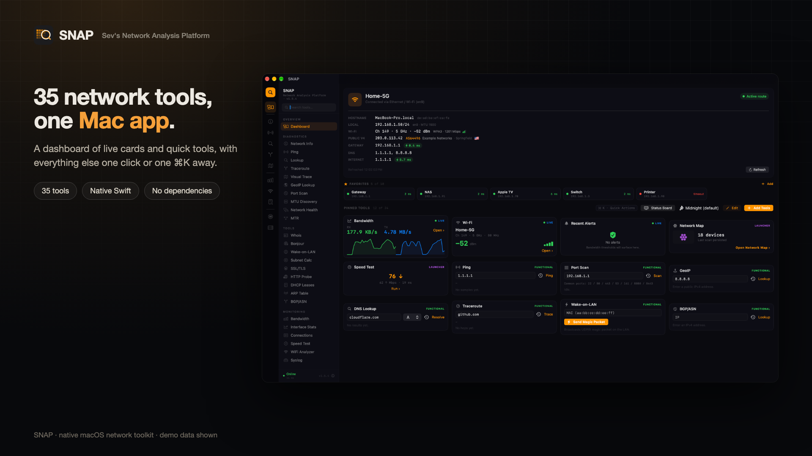
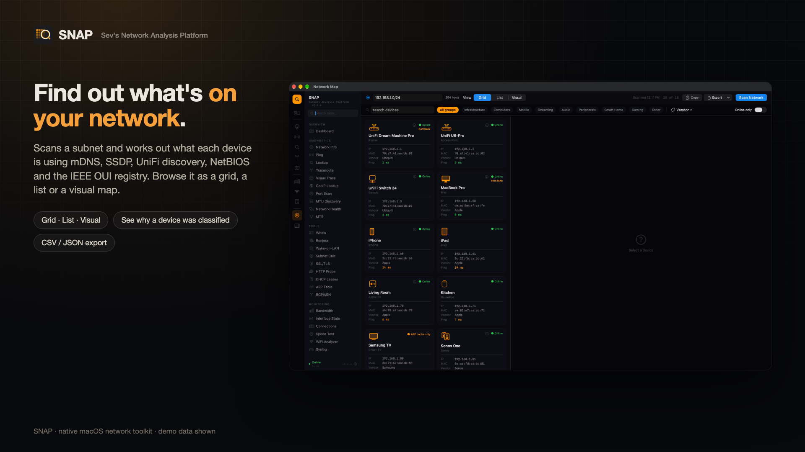
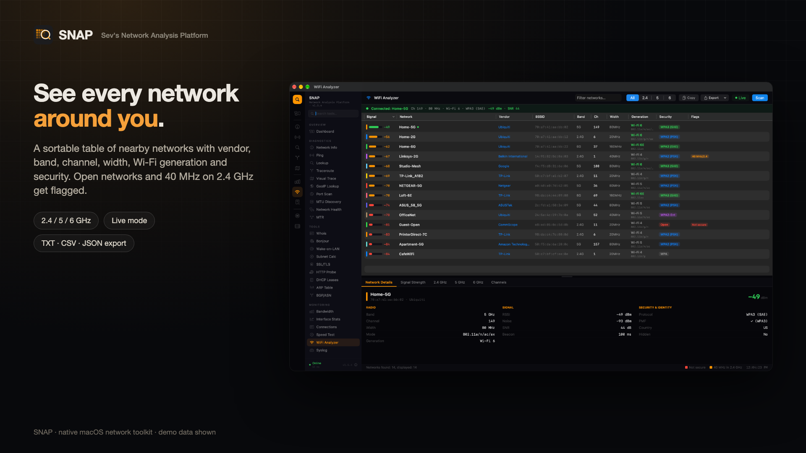
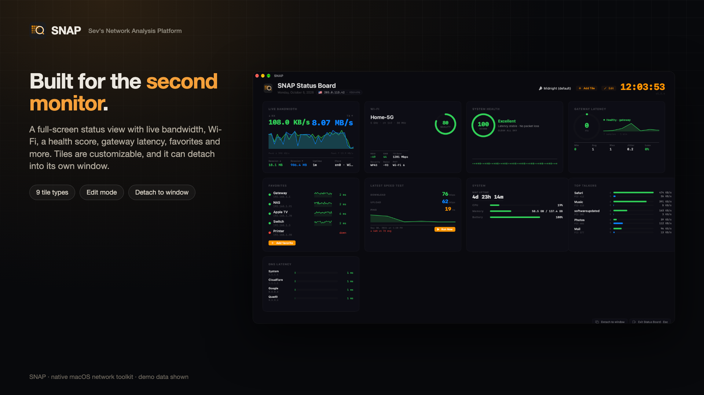
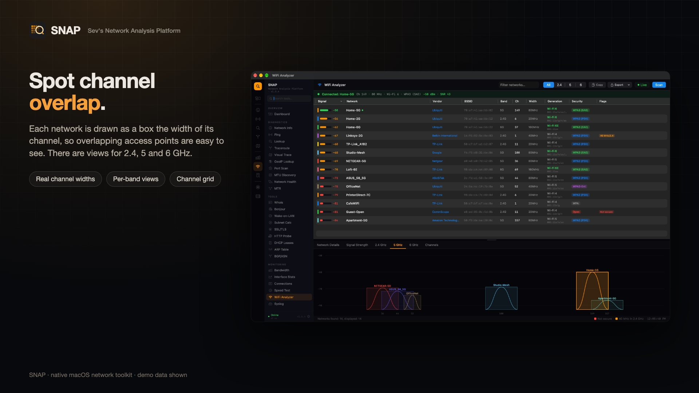
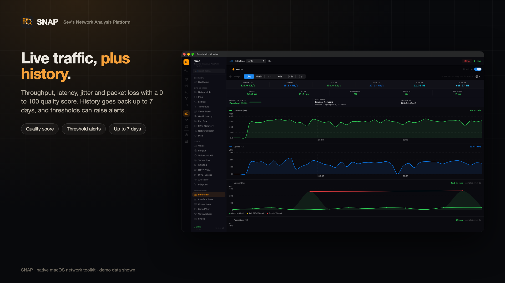
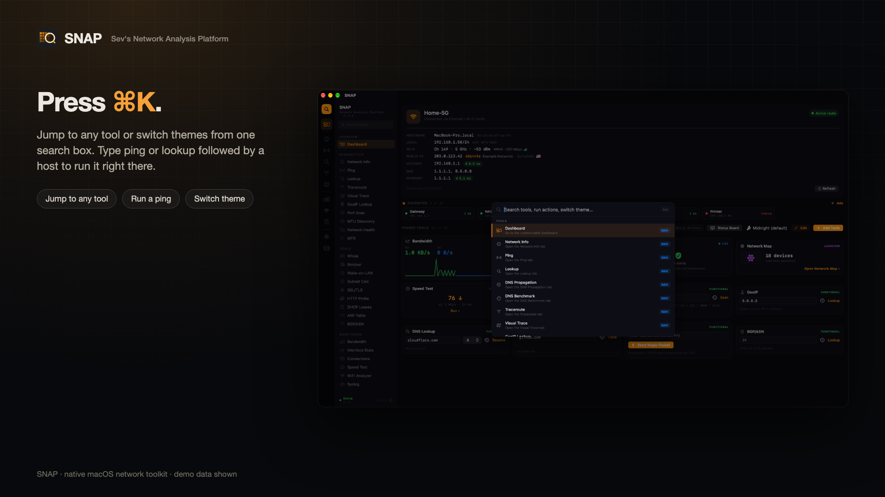
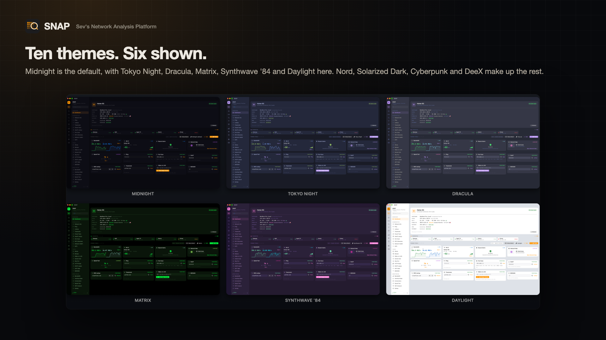

# SNAP — Sev's Network Analysis Platform
**by Sevag Bardakjian**

A professional macOS network utility — sandboxless, built for speed, with ten themes.

No accounts, analytics, telemetry, or crash reporting. See [Privacy & Security](#privacy--security) for every service SNAP contacts, what it stores, and what it can do on your network.

## Screenshots






<details>
<summary>More screenshots</summary>






</details>

*Screenshots were taken in SNAP's Demo Mode; every network detail shown is a placeholder.*

## Features

### Overview
- **Dashboard** — Connection Summary hero card (active interface, Wi-Fi SSID, public IPv4/IPv6, ISP/ASN, gateway + vendor, DNS, latency) plus a **fully customizable grid** of pinned tool cards in three buckets (functional / live / launcher). Layout persists per user, **+ Add Tools** modal, **Edit Mode** to remove. *Reworked in v1.5.0; hero originally introduced v1.2.4*

### Diagnostics — *troubleshoot a target*
- **Network Info** — Per-interface dark cards: Hardware (MAC, link speed/duplex, MTU, carrier), IPv4 with CIDR, IPv6 by scope, Wi-Fi specifics, traffic counters, DHCP lease, "Active route" badge — *redesigned in v1.2.4*
- **Ping** — Configurable count or unlimited mode
- **Lookup** — DNS lookups via DNS-over-HTTPS (A, AAAA, MX, NS, TXT, and more)
- **Traceroute** / **Visual Trace** — One-shot path discovery, optionally geo-mapped
- **GeoIP Lookup** — Map-based IP geolocation with location, network, timezone, and security signals *(grouped under Visual Trace in v1.4.2 — they offer related services)*
- **MTR** — Combined traceroute + per-hop continuous ping with running stats (Welford stddev) — *new in v1.2.3*
- **Port Scan** — Scan hosts for open TCP ports
- **MTU Discovery** — Path MTU via DF-bit binary search, with encapsulation hints
- **Network Health** — Captive portal, DNS hijacking, transparent proxy, outbound port blocking checks (renamed from "Captive Portal" in v1.2.2)

### Tools — *utilities + passive system info*
- **Bonjour** — Browse mDNS/Bonjour services on the local network
- **Wake-on-LAN** — Send magic packets to wake remote machines
- **Subnet Calculator** — CIDR / netmask / host-range calculations
- **SSL/TLS Checker** — Inspect certificates, chains, and TLS configuration
- **HTTP Probe** — Send HTTP requests and inspect responses, headers, timing
- **DHCP Leases** — Parsed `ipconfig getpacket` lease inspector with raw-packet view
- **ARP Table** — L2 neighbor cache with vendor lookup, reverse DNS, optional /24 sweep
- **Whois** — Domain registration lookups *(moved from Diagnostics in v1.2.4)*
- **BGP/ASN Lookup** — *new in v1.4* Team Cymru DNS-based ASN service: ASN, AS organization, BGP prefix, country, registry, allocation date. Accepts IPv4, IPv6, or a bare ASN.

### Monitoring — *live continuous data*
- **Bandwidth** — Live RX/TX charts, latency, packet loss, jitter, TCP retransmits, DNS latency, ISP/ASN info, 0–100 quality score, **threshold alerts**, **SQLite-backed history with Live / 5 min / 1 h / 6 h / 24 h / 7 d ranges** — *history added in v1.2.3*
- **Interface Stats** — Sortable Table with filter chips, search, per-row 60s live sparklines, detail pane with bigger chart — *redesigned in v1.2.4*
- **Connections** — Active socket / connection table
- **Speed Test** — Cloudflare provider + iPerf3 LAN, delegate-based download accurate at 400+ Mbps, persistent history
- **WiFi Analyzer** — *fully revamped in v1.4.2* Sortable native-`Table` networks list (vendor via OUI, mode, generation, width, security, warning flags) over a **resizable** tabbed graph panel:
  - **Network Details** — full per-network breakdown (radio / signal / security)
  - **Signal Strength** — RSSI-over-time with **auto-scaling Y axis**, signal-quality zone bands, and a glow + area-fill highlight on the selected network, plus a stats strip (current / avg / min-max / jitter σ / SNR / quality / trend)
  - **2.4 / 5 / 6 GHz** — spectrum envelopes drawn as real channel-width boxes, axis fitted to the occupied band so channels spread across the full width
  - **Channels** — full per-band grid (sub-bands + DFS tags), click a channel to highlight the tile and open an **inline detail card** with co-channel contention + overlapping-AP interference analysis
  - Live mode, band filter, search, TXT/CSV/JSON export. Root-free (public CoreWLAN only)
- **Syslog** — *new in v1.3* UDP syslog receiver (defaults to port 5140 for unprivileged use). RFC 3164 + RFC 5424 parser, severity / facility / source filters, color-coded severity, 5000-row retention, pause/clear/auto-scroll

### Advanced — *power-user features*
- **DNS Propagation** — Query a hostname across 16 global public resolvers in parallel, with consensus badge *(moved from Diagnostics in v1.2.4)*
- **DNS Benchmark** — Race resolvers across a basket of domains, ranked by latency + loss *(moved from Diagnostics in v1.2.4)*
- **Fingerprint** — Service / OS fingerprinting on remote hosts. **v1.3** adds SNMP probe + a vendor classifier that fuses sysObjectID, SSH banner, HTTP Server, and rDNS into a single vendor + model + role verdict (Cisco / Juniper / Arista / Aruba / Palo Alto / Fortinet / MikroTik / Ubiquiti / etc.)
- **Multi-Host Compare** — Compare metrics across multiple hosts simultaneously
- **Network Map** — Visualize the local network topology with **multi-signal device identification** (mDNS, SSDP, UBNT discovery for UniFi gear, NetBIOS, HTTP banner, reverse DNS, full IEEE OUI registry + vendor-pattern role inference) — *enterprise-grade vendor coverage in v1.3*. Scans any range up to a /16: a subnet (`10.0.0.0/16`), a custom range (`10.0.0.1-10.0.3.254`), a /24 shorthand, or a comma-separated mix. Prefilled from your connection's real subnet; asks before scans over ~1,000 addresses, with a time estimate — *ranges in v1.5.4*
- **SNMP** — *new in v1.3* Read-only SNMP v2c client (ASN.1 BER from scratch, no deps). System Info / Interfaces / Custom OID Walk modes. `sysObjectID` lookup against an enterprise database (Cisco, Cisco Meraki, Juniper, Arista, Extreme, HP/HPE, Aruba, Palo Alto, Fortinet, Check Point, SonicWall, F5, NetScaler, Synology, QNAP, …).
- **Routing Hello** — *new in v1.3* Passive UDP multicast listener for HSRPv1 / HSRPv2 / GLBP — gateway redundancy + load-balancing speakers detected without raw-socket access. Limitations footer documents what OSPF/EIGRP/VRRP/PIM detection would need.
- **UniFi** — *new in v1.4* Authenticate to a UniFi Network Controller (UDM-Pro / Cloud Key / self-hosted Network application or legacy standalone controller) and pull the adopted-device inventory across all VLANs the controller knows. Credentials stored in the macOS Keychain; self-signed certs accepted.
- **Bulk Discovery** — *new in v1.4* Range-driven asset inventory (same range syntax as Network Map, up to 8,192 addresses): aliveness sweep + per-host port scan + SNMP probe + reverse DNS + ARP-based vendor lookup. Concurrent two-phase pipeline. CSV/JSON export shares the schema with Network Map + UniFi for cross-source correlation.
- **Packet Capture** — Capture and inspect network packets

### Additional Features

- **Menu Bar Widget** — Live RX/TX sparklines, Wi-Fi / Network / VPN sections, inline Quick Ping & DNS Lookup
- **Threshold Alerts** — Configure latency / loss / jitter / retransmit / DNS thresholds with consecutive-sample debouncing, native macOS notifications
- **Session Report (HTML)** — `⌘⇧R` saves a single self-contained HTML snapshot of network state + recent alerts
- **Export Results** — Every tool exports to TXT, CSV, or JSON via a consistent action bar
- **Persistent Speed Test History** — Saved across sessions with CSV/JSON export
- **Persistent Bandwidth History** — SQLite-backed, 30-day retention, time-range aggregation
- **Connection Quality Score** — 0–100 rating (Excellent → Critical) derived from latency, loss, jitter, retransmits, and DNS responsiveness
- **Sandboxless Networking** — Direct `getifaddrs` / `sysctl` / raw UDP syscalls — no `netstat` spawning for hot-path sampling
- **Dark-Only UI** — Custom 3-column layout (icon rail + sidebar + main) with NS design tokens throughout
- **XCTest target** — 124 unit tests across SubnetCalculator, DNSWire, OUIDatabase, NetworkMapModel, SNMP (ASN.1 BER round-trip + sysObjectID), Syslog parser (RFC 3164 + 5424), enterprise OUI vendor-pattern inference, CIDR expansion, ARP-cache parsing, WiFi band/channel helpers, connection-health scoring (incl. menu bar dot outage timelines), public-lookup caching, Status Board Wi-Fi readings, and scan-range parsing (CIDR, ranges, limits) — *added in v1.2.3, expanded through v1.5.4*

## Requirements
- macOS 14.0 (Sonoma) or later
- Xcode 15+
- Universal binary (Apple Silicon + Intel)

## Privacy & Security

SNAP has no accounts, analytics, telemetry, ads, or crash reporting, and contains no third-party code. It never sends anything to me. This section lists everything SNAP itself does. If you find something it doesn't cover, please report it.

### Contacted automatically

These happen without a click, while the view in question is open:

| When | Destination | What and why |
|---|---|---|
| From launch, every 10 s, for as long as SNAP runs (it stays in the menu bar after the window closes) | Your router (default gateway) | Ping, for the menu bar health dot |
| While the sidebar is visible, every 15 s | `www.apple.com` (falls back to `www.cloudflare.com`, then `www.google.com`) | A small HTTPS request to confirm you're online |
| While the Dashboard is on screen: when it first opens, every 10 min, whenever your network changes, and when you press Refresh | `api.ipify.org`, `api6.ipify.org` | Your public IPv4/IPv6 address. **These services see your public IP.** |
| Once per public IP per day (sooner if you press Refresh) | `ipinfo.io` | ISP, ASN, and city for that address. **ipinfo sees your public IP.** |
| While the Dashboard is on screen, every 30 s | `1.1.1.1` and your router | Ping, for the latency readouts |
| Once favorites are loaded, every 30 s (10 s while the Status Board is open) | Hosts you added as favorites | Ping |
| When the menu bar popover opens, or you open or return to the Network Info tab | `api.ipify.org` | Your public IP |
| When the Bandwidth monitor starts (opening its tab starts it) | `ipinfo.io` | ISP name |
| While the Bandwidth monitor runs. It keeps running after you switch tabs, until you press **Stop** or close the window | `1.1.1.1` (TCP port 80) and your DNS resolver | Every 3 s, four TCP connections to time latency, jitter, and loss; every 10 s, a lookup of `one.one.one.one` to time DNS |
| While the Status Board is open: on open, then every 10 min | `ipwho.is` | Public IP, ISP, ASN, and country for the header chip |
| While the Status Board's DNS Latency tile is shown, every 10 s | Your system DNS resolver, `1.1.1.1`, `8.8.8.8`, `9.9.9.9` | A lookup of `cloudflare.com`, to time each resolver |

### Contacted only when you use a tool

Tools keep running after you switch to another tab (a ping, a traceroute, a scan, a capture) until they finish or you stop them. Closing the main window stops everything.


- **Anything you type into a tool goes to the target you chose.** That covers Ping, Traceroute, MTR, Port Scan, HTTP Probe, SSL/TLS, MTU Discovery, Wake-on-LAN, SNMP, iperf3, and the UniFi controller.
- **GeoIP Lookup and Visual Trace** → `ipwho.is`. It receives the IP you look up; Visual Trace sends each hop's IP.
- **Dashboard GeoIP card** → `ip-api.com` over **plain HTTP**, so the IP you look up is visible to anyone on the network path.
- **Whois** → WHOIS registry servers, via macOS's `whois` command.
- **BGP/ASN** → DNS lookups against Team Cymru (`asn.cymru.com`).
- **DNS tools** → the resolvers you pick. DNS Benchmark looks up `google.com`, `apple.com`, `cloudflare.com`, `wikipedia.org`, and `amazon.com` by default.
- **Speed Test** → `speed.cloudflare.com` and `www.cloudflare.com`.
- **Captive Portal check** → `captive.apple.com`, `www.msftconnecttest.com`, `cp.cloudflare.com`, `www.gstatic.com`, `detectportal.firefox.com`, and `1.1.1.1` (DNS-over-HTTPS and trace), plus reachability tests to `github.com`, `cloudflare.com`, Gmail's mail servers, and Google's STUN server.
- **Menu bar quick DNS** → `1.1.1.1` (DNS-over-HTTPS).

### On your local network

- **Network Map and Bulk Discovery** (when you click Scan): a ping sweep of the range, the ARP table, mDNS/Bonjour queries, SSDP (UPnP) multicast, Ubiquiti discovery broadcasts plus a unicast probe to every address in the range, NetBIOS name queries, and a read-only HTTP/HTTPS request to each device's web page to read its title. Those page requests accept self-signed certificates and never send credentials.
- **Port Scan**: TCP connection attempts to the ports you choose.
- **Bonjour Browser**: once opened, keeps listening for and querying mDNS services on your local network until the window closes.
- **Syslog receiver**: listens on a UDP port (5140 by default) only while it's running.
- **Packet Capture**: runs macOS's `tcpdump`, which only works if you launch SNAP with `sudo`. Captured packets appear in SNAP and go nowhere else.

Scans and port probes are visible to network monitoring and intrusion-detection systems. **Only scan networks you own or are authorized to test.**

### System tools SNAP runs

`/sbin/ping`, `/usr/sbin/traceroute`, `/usr/sbin/arp`, `/usr/sbin/ipconfig`, `/usr/sbin/netstat`, `/sbin/ifconfig`, `/usr/bin/whois`, `/usr/bin/nettop`, `/usr/sbin/tcpdump`, and `iperf3` if you've installed it. SNAP never asks for your admin password, and it installs no helpers, daemons, or login items.

### Permissions

- **Location Services** (asked at first launch). macOS only shows Wi-Fi network names (SSIDs) to apps with location permission. SNAP never requests your coordinates. If you decline, network names are hidden and everything else works.
- **Local Network** (macOS 15+). Needed for scanning and Bonjour discovery.
- **Notifications** (asked when alerts first load). Used for bandwidth threshold alerts.
- **Keychain**. Used only if you tick *Remember* in the UniFi tool; the password goes into your login Keychain.
- **Full Disk Access**. SNAP never asks for it. Without it, the Status Board's Top Talkers tile may show less data.

### Stored on your Mac

- **Preferences** (`~/Library/Preferences/com.sevagbardakjian.snap.plist`): theme, Dashboard and Status Board layouts, favorites, your last 10 inputs per tool, alert thresholds, speed test history, the last Network Map scan (device names, IPs, MACs, vendors), the UniFi controller address and username, and approved UniFi certificate fingerprints.
- **Bandwidth history** (`~/Library/Application Support/SNAP/bandwidth.sqlite`): per-interface byte counts. Never packet contents.
- **Keychain**: the UniFi password, only if you chose *Remember*.
- **Files** are written only where you choose in a Save dialog (exports, session reports).
- **Clipboard**: SNAP never reads it. It only writes to it when you click Copy.

To remove everything SNAP has stored: delete the app, run `defaults delete com.sevagbardakjian.snap`, delete `~/Library/Application Support/SNAP`, and remove the `com.bardaklabs.snap.unifi` item in Keychain Access if you saved a UniFi password.

### Security notes

- **Not sandboxed.** The App Sandbox would block the system tools and raw network probes listed above, so SNAP runs with the same file access as any app you launch yourself. It reads and writes only what's listed here.
- **Plain HTTP allowed.** App Transport Security is relaxed so SNAP can reach LAN devices with HTTP-only admin pages and `ip-api.com`.
- **UniFi credentials are protected by certificate pinning.** The first time a controller presents a self-signed certificate, SNAP shows its SHA-256 fingerprint and asks you to trust it. After that, a different certificate stops the connection before your credentials are sent. SNAP also refuses plain-HTTP controller URLs.
- **Not notarized.** Current builds are ad-hoc signed and haven't been checked by Apple's notarization service.

## Architecture
- SwiftUI, no third-party dependencies
- App Sandbox **disabled** — required for raw network access (direct distribution only)
- Interface byte counters read via `getifaddrs` / `sysctl` — no process spawning on the hot path
- DNS via DNS-over-HTTPS (lookups) and direct UDP/53 (propagation/benchmark)
- SNMP v2c via ASN.1 BER over UDP/161 (self-contained, no `net-snmp` dependency)
- libsqlite3 (system) for Bandwidth Monitor history
- CoreWLAN for Wi-Fi specifics; SystemConfiguration for routing state
- Full IEEE MA-L OUI registry (39,403 entries) bundled at [SNAP/oui_registry.txt](SNAP/oui_registry.txt), refreshed from <https://standards-oui.ieee.org/oui/oui.csv>

## Building
```bash
open SNAP.xcodeproj
# ⌘⇧K — Clean Build Folder
# ⌘R   — Build & Run
# ⌘U   — Run tests (124 tests in SNAPTests)
```

## Version
Current: **v1.5.4** — see [CHANGELOG.md](CHANGELOG.md)

### What's new in v1.5.4 — persistent tabs, Daylight fix, real scan ranges
Builds clean; all 124 tests pass. Requires macOS 14.0 or later.
- **Tabs keep running and remember their state** — switching tabs used to destroy the tool you left, stopping a running ping, scan, or capture and clearing its results. Every tab you open now stays alive in the background. Automatic background work (Dashboard refreshes, Wi-Fi Analyzer live scans) pauses while its tab is hidden; info tabs (Network Info, ARP, DHCP, Connections, Interface Stats) refresh when you return.
- **Daylight theme fixed** — the app forced dark mode for every theme, so under Daylight the tables, lists, text fields, and gray labels rendered dark or near-invisible. Light/dark mode now follows the theme everywhere, including the menu bar popover (which had white text on a light background) and the detached Status Board.
- **Network Map scans real ranges** — it used to scan exactly one /24 (.1–.254) per entry and silently cut `10.0.0.0/16` down to `10.0.0.1–254`. It now takes any CIDR up to a /16, custom start–end ranges, single hosts, or a mix; prefills your actual subnet; shows a live host count; and asks before big scans, offering your own /24 as a quick alternative. Bulk Discovery uses the same parser, and its label now matches its real 8,192-address limit.
- **Picker labels no longer squeezed** — the Network Map's "View" label wrapped onto two lines when the device count changed width, and the Subnet Calculator's "Input Mode" picker was 43 pt too narrow. Both now size to their content.

### What's new in v1.5.3 — macOS 27 / Xcode 27 compatibility, UniFi pinning, release prep
Mostly a warning cleanup, plus five behavioral fixes, a security hardening, and release prep. Builds clean against the macOS 27 SDK with Swift 6.4; all 122 tests pass. Requires macOS 14.0 or later (these notes originally said 13.0; see the CHANGELOG).
- **UniFi certificate pinning** — the UniFi login used to accept any certificate on the connection carrying your admin credentials. Now a self-signed controller certificate is shown and approved once, then pinned; a changed certificate is refused inside the TLS handshake, before credentials are sent. Plain-HTTP controller URLs are refused.
- **[LICENSE](LICENSE) + [Privacy & Security](#privacy--security)** — proprietary license (free to use, source not open), and an audited list of everything SNAP contacts, stores, and can do on your network.
- **Credited to Sevag Bardakjian** — About window, file headers, session-report footer, and copyright string.
- **Dashboard stops hammering ipinfo.io** — it used to repeat the public-IP and ISP lookups on every 30-second refresh, about 2,900 ipinfo requests a day, enough to get rate-limited. Now the public IP is re-checked every 10 min or when your network changes, and ISP details are fetched once per IP per day. Latency pings still run every 30 s.
- **System Health tells the truth** — the score now counts jitter, packet loss, and Wi-Fi signal on router-scale thresholds, and the Gateway Latency label uses the same model over the whole sample window instead of the latest ping. A connection that used to score 98 "Excellent" next to 64 ms of jitter now reads 43 "Degraded".
- **Real Wi-Fi details on the Status Board** — TX Rate, Security, Noise, and SNR were hard-coded mockup values (TX Rate always said 1441). All six cells are now live CoreWLAN readings; MCS is replaced by PHY (Wi-Fi 4/5/6/6E/7), since CoreWLAN doesn't expose MCS.
- **Menu bar dot judges the last 5 minutes** — it used to go green or red on a single ping. It now uses the same model as the Status Board, so all three agree. It still turns red ~20 s into an outage, and its tooltip explains the color.
- **Status Board "Run Now" actually runs a test now** — it previously only switched tabs *underneath a board that was still covering them*, so nothing happened. Added an autostart handoff token, made board dismissal mode-aware (in-window boards come down, detached second-monitor boards stay up), and forced the internet pane so the test isn't run behind the iPerf3 view.
- **All cross-tool handoffs fixed, not just Speed Test** — `ConsumeHandoffModifier` only fired on `.onAppear`, so a handoff to a tab you were *already* on was never consumed. "Send to Ping" while sitting on the Ping tab was silently broken too. Root cause was a missing `@ObservedObject` — the same SwiftUI view-diffing trap as the v1.5.0 theme-propagation bugs.
- **Swift 6 concurrency (14 warnings → 0)** — marked four pure-computation statics `nonisolated` (`dnsPing`, `runNettop`, `parse`, `ping`) since a `@MainActor` class also isolates its statics, and wrapped four `Timer`/`asyncAfter` callbacks in `Task { @MainActor in … }`.
- **Missing `Combine` import (4 → 0)** — `SidebarFooter`'s `Timer.publish(…).autoconnect()` property exposes a Combine type in a file that never imported Combine.
- **`ViewBuilder` limited-availability (2 → 0)** — `GeoIPView.mapPane` leaked the macOS-14-only `GeoIPMapView` into its opaque return type; both branches now type-erase through `AnyView`.
- **Left deliberately:** 20 `onChange(of:perform:)` deprecation warnings across 11 files (22 as of v1.5.4). These were left on the assumption that SNAP targets macOS 13, where the replacement API doesn't exist. It actually requires macOS 14, so they can now be switched to the newer API. (An earlier draft said 13 across 10 files — that was a miscount of a clean build's output, which logs each site twice.)

### What's new in v1.5.2 — Status Board rework
Full visual + functional pass on the Status Board:
- **9 tile types** (up from 6): existing Bandwidth / Wi-Fi / Alerts (now "System Health") / Favorites / Gateway Latency / Speed Test **plus** three new — **DNS Latency** (bar chart per resolver: System / Cloudflare / Google / Quad9), **System** (Mac uptime + CPU + memory + battery), **Top Talkers** (per-process bandwidth via `nettop`).
- **Enhanced visual language across every tile** — area-fill sparklines with peak markers, ring gauges (Wi-Fi quality, gateway latency, health score), a 4-hour activity timeline under System Health, min/max/avg/jitter/loss stat row under Gateway Latency, session-totals row under Bandwidth, history sparkline + inline **Run Now** button under Speed Test.
- **System Health reimagined** — composite 0–100 score (100 minus penalties for latency, packet loss, and recent alerts) + grade word + "CLEAN FOR 3h 12m" context + colored activity timeline. Actually useful now.
- **Header additions** — theme picker (switch themes without leaving the board) + compact **Public IP chip** with country flag + ISP/ASN (right-click for full host menu).
- **Reusable components** — new `RingGauge`, `AreaSparkline`, `StatusPill`, `ByteFormat` under `StatusBoardTiles.swift` for future tiles.

### What's new in v1.5.1 — post-launch polish
Substantial expansion on top of v1.5.0 features:
- **⌘K Command Palette** (Spotlight-style launcher, smart `ping HOST` / `lookup HOST` inline execution).
- **Status Board** (`⌘⇧B`) is now customizable — 6 tile types (Bandwidth / Wi-Fi / Alerts / Favorites / Gateway Latency / Speed Test), Edit Mode, drag-to-reorder, **Detach to a second monitor** (fullscreen).
- **Favorites**: pinned hosts strip on the Dashboard, up to 10 hosts auto-pinged (30 s idle / 10 s while Status Board is open). Each Favorites-tile row shows an RTT sparkline + hover-reveal ✕ to remove.
- **Right-click any host or IP** anywhere in SNAP (Network Map, ARP, DHCP, Traceroute, Lookup, Connections, Bonjour, Multi-Host, Bulk Discovery, Fingerprint, Visual Traceroute, ConnectionSummary hero rows): Copy / Send to Ping/Traceroute/Port Scan/Lookup/Whois / Find in Map / Add to Favorites.
- **Per-tool input history** on every functional card + full tool (clock-icon menu, last 10 values).
- **Menu bar heartbeat** (colored dot next to the network icon, driven by a 10-s gateway ping).
- **"Why this classification?" popover** on every Network Map device (lists the raw discovery signals that voted on its identity).
- **`dig` → DNSWire migration complete** — no more `/usr/bin/dig` shell-outs anywhere.
- **Service fixes** — Visual Trace map now plots hops via `ipwho.is` (ipinfo.io was rate-limiting anonymous requests; an intermediate `ip-api.com` attempt also failed in the field). Each hop row now shows the nation flag inline with the city/country (🇺🇸 Pasadena, United States). GeoIP now pre-resolves hostnames via `getaddrinfo` before hitting `ipwho.is` (fixes intermittent 404s on CDN-fronted domains).

### What's new in v1.5.0 — customizable Dashboard + Themes
Two headline features plus a god-file split:
- **Customizable Dashboard.** Connection Summary hero stays anchored; everything below is a user-pinnable grid of tool cards across **24 entries** in three buckets — **Functional** (10 inline form-and-result cards: Ping, Lookup, Port Scan, Subnet, BGP, Traceroute, GeoIP, Whois, HTTP Probe, Wake-on-LAN), **Live** (3 auto-refreshing summaries: Bandwidth, Wi-Fi, Recent Alerts), **Launcher** (11 tiles that open the full tab: Network Map, Packet Capture, Bulk Discovery, UniFi, SNMP, SSL/TLS, MTU Discovery, MTR, Syslog, Speed Test, Connections). Toolbar gets **+ Add Tools** (categorized modal), **Edit Mode** (✕ to remove, **drag-to-reorder** — the grid rearranges live as you hover the dragged card over targets), and **Reset Layout**. Layout persists per user.
- **Themes.** App-wide color theming with a picker in the Dashboard toolbar and an `Appearance` menu in the menu bar. Ten themes ship: Midnight (default), Daylight (light), Nord, Solarized Dark, Tokyo Night, Dracula, Matrix, Cyberpunk, DeeX (Deus Ex: HR gold-on-black), Synthwave '84. The central `NS` palette forwards to a `ThemeManager` singleton, so theme changes propagate instantly to every chrome view, hero card, and dashboard card.
- **Power-user combo.** Six small features that compose: **⌘K Command Palette** (Spotlight-style launcher with smart `ping HOST` / `lookup HOST` inline execution), **Status Board** (fullscreen ambient display on `⌘⇧B`), **Favorites** (up-to-10 pinned hosts auto-pinged every 30 s, with a strip above the Dashboard), **right-click any host** (Copy / Send to Ping / Traceroute / Port Scan / Lookup / Whois / Find in Map / Favorites), **per-tool input history** (clock-icon menu with last 10 values on every Ping/Lookup/Whois/Traceroute/Port Scan/GeoIP/BGP/HTTP input), and **menu bar heartbeat** (colored dot driven by gateway ping every 10 s). A 3D card-tilt effect was scoped but dropped before ship — it broke hit-testing on nested TextFields.
- **"Why this classification?" popover.** Every device in the Network Map's card view has a small **ⓘ** button (when signals exist) that opens a popover listing the raw discovery signals (mDNS / SSDP / NetBIOS / OUI / etc.) that voted on the device's identity. Trust or refute the classification at a glance.
- **Right-click coverage is comprehensive** — every result surface in SNAP that has a meaningful per-row host now supports the host context menu: Network Map (card + table), ConnectionSummary hero rows, ARP Table, DHCP Leases, Traceroute hops, Lookup answers, Connections (local/remote), Bonjour service IPs, Multi-Host Compare rows, Bulk Discovery, Fingerprint (IPv4/IPv6/Reverse DNS), and Visual Traceroute hops. Same menu everywhere: Copy / Send to Ping / Traceroute / Port Scan / Lookup / Whois / Find in Map / Add to Favorites.
- **Status Board** is customizable: pick from six tile types (Bandwidth, Wi-Fi, Alerts, Favorites, Gateway Latency, Latest Speed Test), drop tiles in Edit Mode, persists per user. **Detach to window** button pops it to a second monitor (fullscreen) if connected. `⌘⇧B` toggles in-window mode. Header now uses the real app icon.
- **`dig` → DNSWire migration.** The last three `dig` shell-outs in Fingerprint moved to the native UDP/53 querier. SNAP no longer invokes `/usr/bin/dig` anywhere; remaining shell-outs are `ping`, `traceroute`, and `arp`.
- **First-launch Quick Tour.** A 5-slide welcome modal introduces the customizable Dashboard, the 38-tool sidebar, the 10 themes, and key shortcuts. Opens once on first launch; reopen anytime from **Help → Quick Tour…**
- **Refactor:** `DeviceIdentifier.swift` (1351 LOC) split into three focused files — `DeviceIdentity.swift` (types + role-classification), `DeviceIdentifier.swift` (orchestrator + simple probes), `DiscoveryProbes.swift` (NetBIOS/SSDP/UBNT/mDNS). No behavior change.
- **Known limitation:** the macOS sidebar and `.regularMaterial` system surfaces don't fully respect custom themes (especially Daylight) — full bleed-through is deferred to a follow-up.

### What's new in v1.4.5 — stability: crash, hang & lifecycle fixes
A review-driven stability release (no new features):
- **Crash fixes** — input-validation traps in Port Scan (reversed ranges), Subnet Calc (`/32` at the address-space edges, now RFC-3021-correct for `/31`), DNS query builder (oversized labels), SNMP OID encoding (X.690 arc validation); NULL `ifa_addr` guards across all 12 `getifaddrs` walks.
- **Hang fixes** — three remaining drain-after-wait pipe deadlocks (Connections `netstat`, `ifconfig -a`, Bulk Discovery `arp`); Syslog no longer busy-spins on dead flows; Port Scan no longer leaks a connection per closed port.
- **Lifecycle** — switching tools now stops the running work (ping/traceroute/tcpdump/syslog listener/multicast joins/live WiFi scan/scans); Speed Test **Stop** genuinely aborts the transfer and terminates iperf3; stale lines from a stopped run can no longer interleave into a new run's table (the scrambled-chart bug).
- **Removed** the broken global Export sheet (⌘⇧E, always exported empty) — per-tool export and ⌘⇧R session report are unchanged.
- **Version strings single-sourced** from the bundle (`AppInfo.version`) — menu bar / session reports no longer show a stale version.

### What's new in v1.4.4 — shell-out → native APIs
First pass at replacing CLI subprocess spawns with native system calls (robustness + a step toward a sandboxable Lite):
- **Default gateway / primary interface** now read from `SCDynamicStore` (`RouteInfo`) instead of parsing `netstat -rn` — collapsed 7 call sites to 1.
- **System DNS resolvers** read from `SCDynamicStore` (`DNSInfo`) instead of `scutil --dns`.
- **DNS A-record resolution** via `getaddrinfo` (was `/usr/bin/host`); **service banner grab** via `NWConnection` (was `/usr/bin/nc`); Menu Bar gateway no longer spawns `/sbin/route`.
- Remaining shell-outs (`ping`, `traceroute`, `arp`, `dig`) are deferred to later passes; `ipconfig`/`ifconfig` are kept (no clean public-API equivalent).

### What's new in v1.4.3 — technical-debt cleanup
A maintenance release focused on robustness and consistency (no new features):
- **`Shell.run` hardened** — drains the subprocess pipe to EOF *before* `waitUntilExit()`, eliminating a latent deadlock when a command emitted more than the ~64 KB pipe buffer; added a 60-second watchdog that terminates runaway processes.
- **UI design-token migration** — replaced raw `Color(red:…)` literals with shared `NS.*` design tokens across ~18 view files, unifying the look (the older tabs now match the newer ones). Single source of truth for the palette.
- **Export consistency** — added the standard TXT/CSV/JSON action bar to 12 more tabs (Ping, Lookup, Whois, Traceroute, Visual Trace, Port Scan, HTTP Probe, SSL/TLS, Fingerprint, Connections, Multi-Host, GeoIP).
- **Parser test coverage** — +14 tests covering CIDR expansion (Bulk Discovery), ARP-cache parsing (ARP Table), and WiFi band / channel / sub-band helpers — the logic most prone to silent breakage on OS updates.

## Roadmap
- **v1.5** — HTTP/2+3 inspector, TLS fingerprinting + cert chain extraction on mgmt portals (cert expiry monitoring), DNSSEC validation, SNMPv3 (USM auth+priv), SNMP trap receiver, Sparkle auto-update
- **v2.0 Pro** — Multi-site uptime dashboard, LaunchAgent daemon, Widgets, anomaly-baseline alerts, NetFlow/sFlow collector
- **Lite** — App Store sandboxed variant

## License
Proprietary — © 2025–2026 Sevag Bardakjian. All rights reserved. SNAP is free to download and use; the source code is not open source. See [LICENSE](LICENSE).
